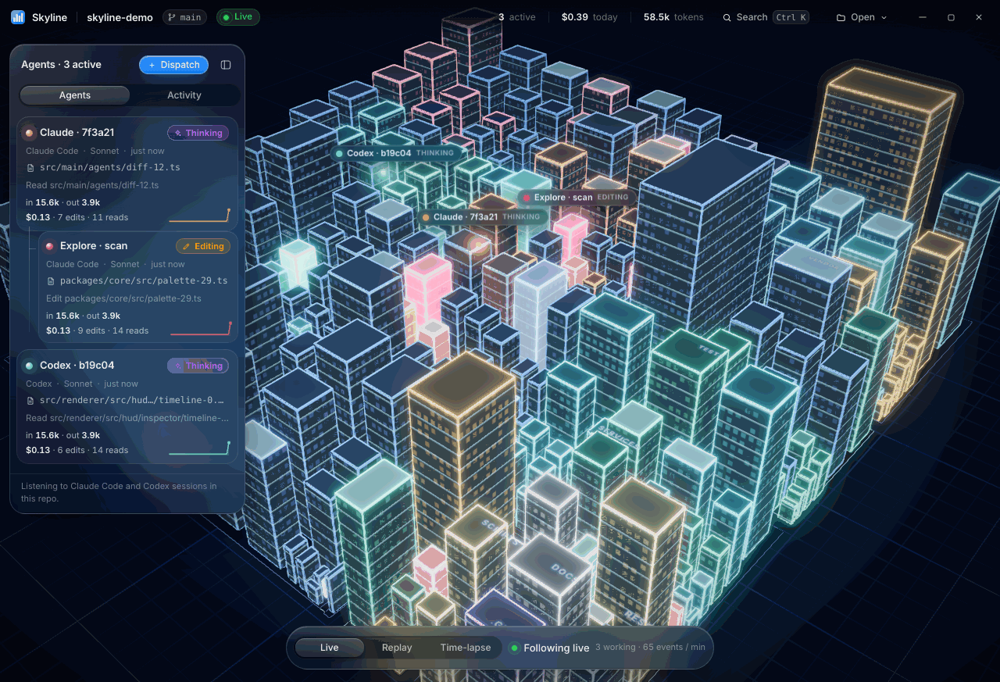
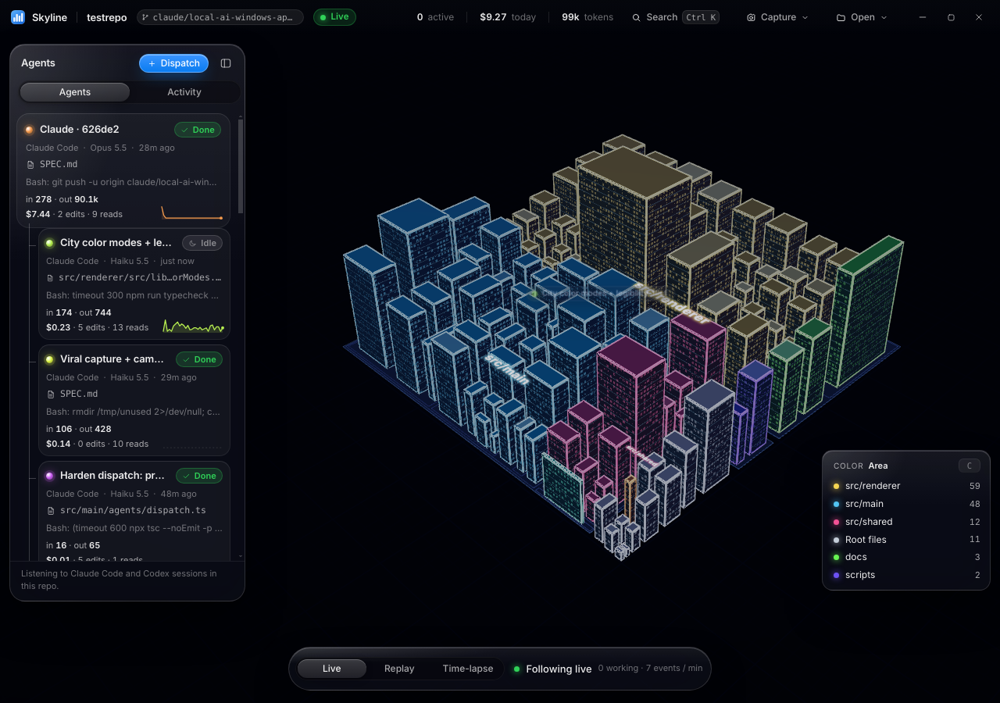
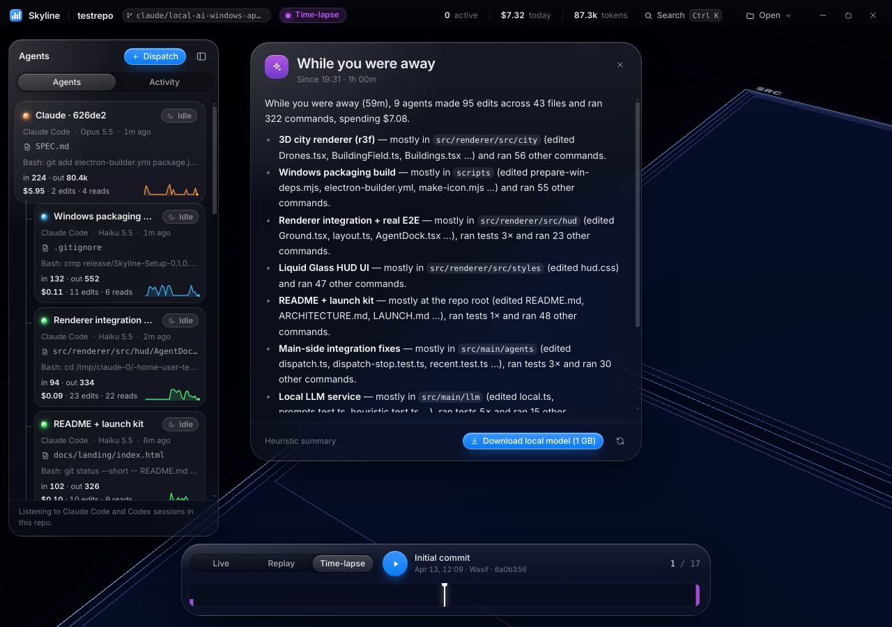

<div align="center">

# Skyline

**Mission control for your AI coding agents — as a living city.**

<a href="docs/screenshots/city.png">
  
</a>

[](LICENSE)


[Download](../../releases) · [Build from source](#build-from-source) · [Architecture](docs/ARCHITECTURE.md) · [Contributing](CONTRIBUTING.md)

</div>

## Why

Developers now run Claude Code, Codex CLI and their subagents in parallel, across many terminals. Nobody can see what they are doing, where they are editing, or what it costs.

Skyline puts every agent on one map. Your repo becomes a city, each agent becomes a drone, and you can watch the work land as it happens.

## See it on a real repo

<a href="docs/screenshots/real-city.png">
  
</a>

*Skyline watching the AI agents that built it — each card in the dock is a real Claude Code session or subagent, with live tokens and cost.*

## Features

- **Living city of your repo.** Every file is a building and every folder a district. Heights follow lines of code. Neighborhood names are drawn on the ground.
- **Color modes.** Press `C` to color the city by neighborhood (*area*), by *language*, by *churn* (how often a file was committed) or by *age* (when it last changed). A legend chip in the corner lists the top entries.
- **Agents as drones.** Tracks Claude Code and its subagents, and Codex CLI. Edits from anything else (Cursor, your editor, you) show up as *Unattributed*. Drones fly to the files they touch, and buildings pulse and sprout scaffolding while agents edit them.
- **Live cost and tokens per agent.** Input, output and cache tokens for every agent, priced against current Claude rates.
- **Replay and git time-lapse.** Scrub back through agent events, or scrub the git history from the first commit to HEAD and watch the city grow.
- **Inspector with local-LLM Explain.** Select a building for its path, size, commits, the agents that touched it, recent activity, imports and a read-only preview. *Explain* describes the file with a model that runs on your machine.
- **"While you were away" digest.** A plain-English summary of what the agents did, written by a local model (Qwen2.5-Coder 1.5B, optional download of about 1.1 GB). Without the model, a heuristic digest is generated instantly. It opens automatically when you return after more than ten minutes away.
- **Snapshot and flyover.** Press `S` for a branded PNG of the framed city with a stats card, copied to the clipboard. Press `Shift`+`S` for a 10-second cinematic WebM flyover. Both are also in the title bar's *Capture* menu.
- **Dispatch agents from the app.** Launch Claude Code or Codex with a prompt. Optionally run it in an isolated git worktree so it cannot collide with your edits.
- **Command bar.** `Ctrl+K` / `⌘K` jumps to any file or agent, runs an action or opens the dispatch sheet.
- **Recent agent activity on the Welcome screen.** Skyline lists the folders where Claude Code and Codex sessions ran in the last seven days, so you can jump straight back into a repo your agents are already changing.

<p align="center">
  
</p>

<p align="center"><em>The digest opens when you return. Without the local model, the heuristic summary appears at once.</em></p>

## Privacy

Skyline is local-first. It has no accounts, no telemetry and no cloud service.

- **What it reads:** agent transcripts in `~/.claude/projects/**/*.jsonl` (Claude Code) and `~/.codex/sessions/**/rollout-*.jsonl` (Codex CLI), limited to sessions whose working directory is inside the open repo. It also reads your repo: file names, sizes, line counts, imports, and git history through your local `git`.
- **What leaves your machine:** nothing from Skyline itself. The only network request it can make is the optional model download from Hugging Face, which starts only when you click *Download local model*.
- **What the agents do:** Claude Code and Codex still talk to their own providers exactly as they would without Skyline. Skyline does not change that.

## Install

Download `Skyline-Setup-<version>.exe` (installer) or `Skyline-Portable-<version>.exe` (no install) from [Releases](../../releases). Windows, x64.

Builds are not code-signed, so Windows SmartScreen may warn on first launch.

### Build from source

Requires Node.js 22 (the version CI uses) and npm.

```bash
npm ci
npm run dev        # run the app with hot reload
npm run dist:win   # build the installer and portable exe into release/
```

`npm run dist:win` can also run from Linux. It fetches the Windows native binaries first (`scripts/prepare-win-deps.mjs`).

## Keyboard shortcuts

| Keys | Action |
|---|---|
| `Ctrl` + `K` (`⌘K`) | Command bar: jump to a file or agent, run an action |
| `Ctrl` + `O` | Open another repository |
| `D` | Dispatch an agent (needs an open repo) |
| `G` | Digest of the last hour |
| `I` | Toggle import arcs for the selected building |
| `F` | Frame the whole city (clears the selection) |
| `C` | Cycle the color mode: area, language, churn, age |
| `S` | Snapshot: framed PNG with a stats card, copied to the clipboard (needs an open repo) |
| `Shift` + `S` | Flyover: a 10-second WebM orbit of the city (needs an open repo) |
| `1` / `2` / `3` | Live / Replay / Time-lapse |
| `Space` | Play or pause Replay or Time-lapse |
| `←` / `→` | Step to the previous or next event (Replay) or commit (Time-lapse) |
| `Esc` | Cancel a running capture, else close the top overlay, then clear the selection, then clear agent focus |
| `Ctrl` + `Enter` | Launch the agent in the Dispatch sheet |

## How it works

Skyline is one Electron app with three parts. The **main process** tails agent transcripts incrementally, scans the repo, watches the filesystem and git, and keeps per-agent state (tokens, cost, files, status). The **preload** script exposes a typed `window.skyline` API. The **renderer** draws the city with three.js (React Three Fiber) and the HUD with React and zustand.

See [docs/ARCHITECTURE.md](docs/ARCHITECTURE.md) for the process map, data flow, the session-log formats Skyline parses, and the city layout. [SPEC.md](SPEC.md) has the full product and engineering spec, including color modes, neighborhoods and captures.

## Roadmap

- Native session support for Gemini CLI and Cursor (Cursor edits show as *Unattributed* today)
- macOS and Linux builds
- Multi-repo "metro" view
- MCP server, so agents can see each other's work
- Team mode

## Contributing

Issues and pull requests are welcome. Start with [CONTRIBUTING.md](CONTRIBUTING.md) for setup, scripts and conventions.

## License

[MIT](LICENSE). Copyright (c) 2026 Skyline contributors.

## Credits

*Built overnight by a swarm of AI agents. Skyline watched them build it.*

City models and textures: [Kenney City Kit](https://kenney.nl) (CC0). Full credits in [docs/CREDITS.md](docs/CREDITS.md).
