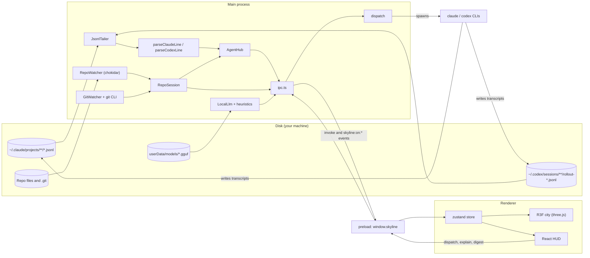

# Architecture

Skyline is one Electron 33 app with three parts: a **main** process that reads agent transcripts and the repo, a **preload** script that exposes a typed API, and a **renderer** that draws the city and the HUD. Everything runs on the machine. The only network request is the optional local-model download.

## Processes

### Main process (`src/main`)

| Module | Role |
|---|---|
| `index.ts` | Creates the frameless window (hidden title bar, 44 px overlay) and registers IPC. |
| `ipc.ts` | `ipcMain` handlers for each `SkylineAPI` method. Pushes `agents`, `event`, `repo`, `llm`, `digest` and `history` to the renderer. |
| `session.ts` (`RepoSession`) | Everything alive while one repo is open: snapshot, `RepoWatcher`, `GitWatcher`, `AgentHub`, cached history. Emits `repo` debounced to 500 ms (at most 2 s of waiting). |
| `agents/hub.ts` (`AgentHub`) | Finds Claude Code and Codex transcripts for the repo, tails them, applies new lines in timestamp order, keeps per-agent state (tokens, cost, files, status) and attributes filesystem changes. Emits `agents` (250 ms debounce) and live `event`. Keeps the last 20,000 events. |
| `agents/tail.ts` (`JsonlTailer`) | Remembers a byte offset per file, returns only complete new lines, and resets on truncation or rotation. |
| `agents/claude.ts`, `agents/codex.ts`, `agents/common.ts` | Pure line parsers. Unknown shapes are ignored, not rejected. |
| `agents/recent.ts` | Lists transcripts from the last 7 days for the Welcome screen. Resolves the Codex session id of a dispatched run. Reads only file names, mtimes and the first lines of each file. |
| `agents/dispatch.ts` | Starts `claude` or `codex` runs, optionally in a git worktree, and keeps a registry so `stopAgent` can end them. |
| `repo/scan.ts`, `repo/imports.ts`, `repo/ignore.ts` | Builds the snapshot: files, language, LOC, bytes, imports (regex, best effort) and churn. Skips `.git`, `node_modules`, `dist`, `build`, `out`, `.next`, `venv`, `release` and similar, plus files over 1 MB. |
| `repo/watch.ts` | chokidar watcher for the repo. Emits forward-slash, repo-relative paths. |
| `repo/git-watch.ts` | chokidar on the parts of `.git` that move with HEAD, branches and history. Emits one change after a quiet period. |
| `repo/git.ts` | Git through the `git` CLI (`log`, branch, churn). Every call degrades to `null` or `[]` if git is missing. |
| `repo/read.ts`, `repo/paths.ts` | Path guard for renderer-supplied paths, and bounded reads (200 KB) for the preview and Explain. |
| `llm/local.ts` (`LocalLlm`) | node-llama-cpp wrapper: lazy model load, single-flight generation queue, download with progress. |
| `llm/heuristic.ts`, `llm/activity.ts`, `llm/prompts.ts`, `llm/text.ts` | Offline digest and explanation fallbacks, shared activity aggregation, and token-budgeted prompts. |
| `store.ts` | `settings.json` and the `models/` folder, both under Electron's `userData`. |

### Preload (`src/preload/index.ts`)

Exposes `window.skyline`, typed as `SkylineAPI` in `src/shared/types.ts`, through `contextBridge`. Each method is an `ipcRenderer.invoke` on a channel name from `src/shared/ipc.ts`. Event subscriptions return a disposer function.

### Renderer (`src/renderer/src`)

| Area | Contents |
|---|---|
| `state/store.ts` | zustand store: repo snapshot, agents, events, git commits, mode (`live`, `replay`, `git`), selection, focus. |
| `lib/ui.ts`, `lib/actions.ts` | UI-only state (overlays, scanning, dock tab) and cross-component actions such as open repo and set mode. |
| `city/` | Three.js scene through React Three Fiber. `CityCanvas` hosts it. `BuildingField` draws every building as one `InstancedMesh` with `buildingShader`. `Drones` moves each agent with a critically damped spring. `Ground`, `Sky`, `Overlays` (scaffolding, spotlight, import arcs), `Effects` (bloom, tone mapping, SMAA, vignette) and `CameraRig` (intro swoop, fly-to, auto-orbit after 25 s idle). `Effects` is mounted only when the GPU keeps up and reduced motion is off. `geom.ts` stretches layout heights for display. |
| `hud/` | React overlays: `TitleBar`, `AgentDock` (agent cards and activity tab), `Inspector`, `Timeline` (Live / Replay / Time-lapse), `CommandBar`, `DispatchSheet`, `DigestCard`, `Welcome`, `ActivityFeed`, `Toasts`. |
| `App.tsx` | Keyboard map, digest on return after more than 10 minutes away, and the lazy-loaded city behind a fallback. |

## Data flow

Dispatched agents write their own transcripts, so they reach the hub through the same path as any other agent session.

## Agent telemetry

**Session sources.** Only sessions whose working directory is the repo root or inside it are counted. A file is rejected once its cwd is known to be outside the repo.

**Ordering and deduplication.** Lines from all files are sorted by timestamp before they are applied. Claude Code streams one assistant message as several lines that share a `message.id`, so the hub stores the last usage per message id and adds only the difference.

**Codex totals.** `token_count` events carry cumulative totals. The hub adds only the growth. A counter reset counts the whole new value. Codex input includes cached tokens, so the hub bills the cached part as cache reads and the rest as fresh input.

**Status.** An agent is `editing`, `reading`, `running`, `thinking` or `done` depending on its last event type, if that event is within 8 s. Otherwise it is `idle` for up to 10 minutes of inactivity, then `done`.

**Unattributed changes.** A filesystem change that no agent event touched within ±3 s becomes an event for the pseudo agent `fs` (shown as *Unattributed*). It is emitted after a 3 s wait, so late agent lines can still claim it.

**Worktrees.** Edits made in a dispatched worktree (`<repo>/.skyline/worktrees/<id>`) are mapped back to the main checkout's path, so they land on the same building.

## Session-log formats

### Claude Code

- **Location.** `~/.claude/projects/<encoded cwd>/<sessionId>.jsonl`. Subagents live in `<sessionId>/subagents/*.jsonl`, with a `.meta.json` next to each one that holds the description.
- **Encoded cwd.** Every non-alphanumeric character becomes `-`. For example, `C:\dev\app` becomes `C--dev-app`.
- **Lines.** `type: "assistant"` carries `message.content` (`text`, `thinking`, `tool_use`) and `message.usage`. `type: "user"` carries `tool_result` blocks.
- **Tool mapping.**

  | Tool | Event |
  |---|---|
  | `Read`, `Grep`, `Glob`, `LS` | `read` |
  | `Edit`, `MultiEdit`, `NotebookEdit` | `edit` (with added and removed line counts) |
  | `Write` | `create` (becomes `edit` if the file was already known) |
  | `Bash` | `command` |
  | `Task`, `Agent` | `spawn` (subagent) |

  File paths are absolute in the log and are made repo-relative.

### Codex CLI

- **Location.** `~/.codex/sessions/YYYY/MM/DD/rollout-*.jsonl`. Each line is `{ timestamp, type, payload }`.
- **Session.** `session_meta.payload.cwd` gives the working directory and is checked against the repo.
- **Commands.** `response_item` with `function_call` (name `shell`, `arguments.command[]`) or `local_shell_call` becomes a `command`.
- **Patches.** `custom_tool_call` or `function_call` named `apply_patch` is parsed for `*** Add File:`, `*** Update File:`, `*** Delete File:` and `*** Move to:`. Added and removed lines are counted from the `+` and `-` lines.
- **Usage.** `event_msg` with `payload.type: "token_count"` carries `info.total_token_usage`.

## City layout

Implemented in `src/shared/layout.ts`. It is pure and deterministic: the same snapshot always gives the same layout.

1. **Tree.** Each file path becomes a leaf. Directories become districts. Children are sorted by name.
2. **Weights.** A leaf's weight is `max(loc, 8)`. Each district's area is the sum of its children's areas.
3. **Treemap.** The squarified treemap (Bruls, Huijbregts and van Wijk, 2000) divides the square recursively by area. This keeps cells close to square. See `squarify()` and `buildLayout()`.
4. **Streets and plates.** Sibling districts are separated by 1.2-unit streets at every depth. Each district plate is inset by half a street per side.
5. **Buildings.** Each building is inset 15% per side inside its cell, with a minimum footprint of 0.4 where the cell allows it.
6. **Height.** Layout height is `h = 0.6 + 2.2 · log2(1 + loc / 20)`. The renderer stretches it for display in `src/renderer/src/city/geom.ts` with `towerHeight()`, which is `0.6 + 2.4 · (h − 0.6)^1.15`, capped at 60 units.
7. **Size.** The whole city is a 120 × 120 unit square (`CITY_SIZE`), whatever the repo size.

## Renderer v2

The v2 city replaces the procedural boxes with real models. The design brief is [EPIC_CITY.md](EPIC_CITY.md). Everything is in `src/renderer/src/city/`.

- **Assets.** `node scripts/import-kenney.mjs <dir>` takes the Kenney City Kit packs, keeps the curated GLBs, strips their external texture references, remaps the UVs into one stacked colormap atlas, measures each model, and writes `city/assets/models/` and `city/assets/textures/colormap.png`. It also generates `city/assets/manifest.ts`, which the loader reads. Re-run the script rather than editing the manifest.
- **One InstancedMesh per model.** `BuildingField.ts` puts every file in the InstancedMesh for its model id. `modelPicker.ts` picks the model and scale for each file. Per-building state (color, glow, selection, height) lives in slot-indexed arrays that the field writes each frame.
- **Windows.** `assets/windows.ts` groups the window triangles of each model into panes and writes one id per vertex, `aWin`. `buildingShader.ts` lights each pane as a whole, lit or dark, and flickers it on the same clock as the sky.
- **Picking.** `picking.ts` tests a ray against a uniform XZ grid of building boxes. It walks the cells the ray crosses (Amanatides-Woo DDA) and slab-tests each box in those cells. `THREE.Raycaster` never runs over the instances.
- **Streets.** `streets.ts` plans the road network as plain data. It rasterizes the free space between district plates into street cells, then autotiles each cell with the road piece whose openings match its neighbors. `Roads.tsx` instances the result and adds the street lamps.
- **Traffic.** `lanes.ts` derives one lane per direction from the same layout, offset from each centerline. `Traffic.tsx` draws every car as one additive light streak on a shared buffer.
- **FX.** `fx/` holds the agent effects. `fx/pools.ts` keeps one `Points` object for all particles and one instanced mesh for all ground rings, so the FX layer costs a fixed number of draw calls. `fx/core.ts` relays store events to the FX systems, and `FxStage.tsx` steps them once per frame.
- **Director.** `shots.ts` is pure. It chooses the next shot (orbit, follow, crane, reveal or flythrough) and computes the camera pose. `Director.tsx` runs it every frame, and `CameraRig.tsx` applies the view.
- **Budget.** `modelPicker.ts` keeps the triangle total under `TRI_BUDGET` (3,000,000). Over budget, the smallest files by LOC are degraded first.

Test hooks: `window.__skylineStats()` (calls, triangles, geometries, textures), `window.__skylineFxStep(seconds)`, `window.__skylineTrafficStep(seconds)` and `window.__skylineDirectorStep(dt)`. Verify changes in the built app, because packaged builds load from `file://`.

## Pricing

Prices live in `src/shared/pricing.ts` as `MODEL_PRICES`, in USD per 1M tokens for input, output, cache read and cache write.

- Matching is a case-insensitive substring test on the model id. The first match wins, so more specific entries come before general ones (for example `opus-5-5` before `opus`).
- Unknown or missing models use `DEFAULT_PRICE`.
- `costUsd()` turns a token usage into dollars. `modelLabel()` gives display names such as `Opus 4.5`.
- Tests are in `src/shared/__tests__/pricing.test.ts`.

To add a model, insert an entry in order and add a test case.

## Local model

- **Model.** `Qwen2.5-Coder-1.5B-Instruct`, Q4_K_M GGUF, pulled from Hugging Face on first request and stored in `userData/models/`.
- **Lazy.** Nothing loads until a digest or explanation is requested. The model is then loaded once and shared by all callers through a single-flight queue.
- **Budget.** Context is 4096 tokens. Prompts are sized with a 3-characters-per-token estimate. Generation is capped at 350 tokens and times out after 5 minutes.
- **Fallbacks.** If the model is not on disk, is still busy, or fails, the heuristic digest or explanation is returned instead. A digest that is still generating after 20 s is returned as the heuristic (model label `heuristic (LLM still thinking)`), and the model's version follows as a `digest` event.

## Dispatch

- **Claude Code.** `claude -p <prompt> --output-format stream-json --verbose --permission-mode acceptEdits`. The session id is read from the first stream-json lines. If it does not arrive within 20 s, the run is tracked as `pending-<id>`.
- **Codex.** `codex exec --full-auto <prompt>`. The run is linked to its rollout file, which is found by polling for up to 60 s.
- **Worktrees.** When the isolated option is on, the run starts in a new worktree at `<repo>/.skyline/worktrees/<id>` on branch `skyline/<id>`.
- **Processes.** Output goes to a log file, not a pipe. `stopAgent` ends the process: SIGTERM first, then a forced kill after 3 s.
- **Limits.** Prompts are capped at 100,000 characters, or 7,000 on Windows, where the command line is the constraint.

## Testing and build

| Command | What it does |
|---|---|
| `npm test` | Runs the vitest suite (23 files). Covers parsers, the tailer, layout, pricing, git, watchers, dispatch and worktrees, the local model and IPC. |
| `npm run typecheck` | Type-checks `tsconfig.node.json` (main, preload, shared) and `tsconfig.web.json` (renderer). |
| `npm run build` | Bundles main, preload and renderer into `out/` through electron-vite. |
| `npm run dist:win` | Builds the Windows NSIS installer and portable exe into `release/`. |
| `npm run dev` | Starts the app with the electron-vite dev server. |

CI (`.github/workflows/build.yml`) runs typecheck, tests, build and packaging on `windows-latest`. Tagged `v*` pushes publish the executables to a GitHub release.

Test fixtures are in `src/main/agents/__tests__/fixtures/`. The demo city (`src/renderer/src/city/dev/fixture.ts`) is a generated repo of about 400 files with three simulated agents. It backs the "Try the demo city" button and the screenshots.
